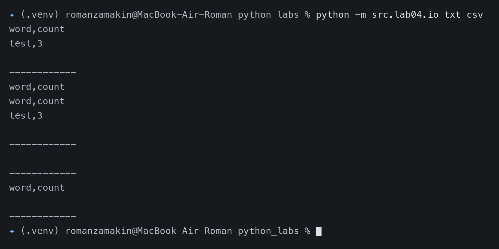
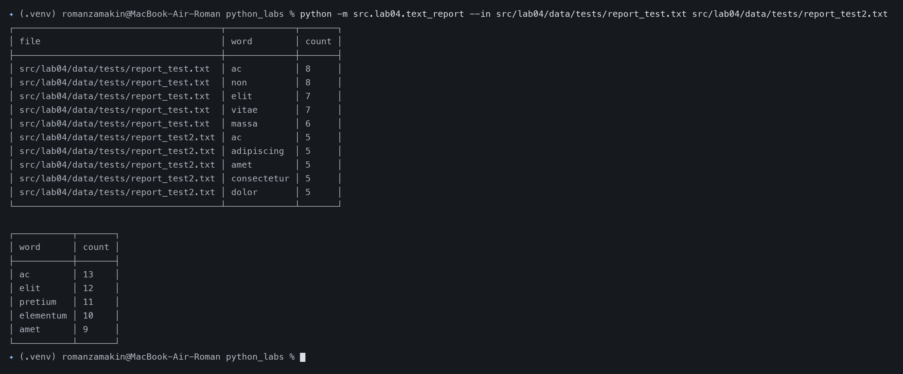

# ЛР04

# Предисловие

## 1. top_n
Функция адаптирована под требования 4 лабораторной работы: при передаче `n = -1` возвращается полный отсортированный список всех найденных слов без усечения.

## 2. Добавлен модуль tables в /lib/
В модуле реализованы две функции:
- `check_rows` — проверяет совпадение длины строк с заголовком и отсутствие пустых ячеек.
- `create_table` — строит таблицу с рамками из псевдографики под ширину содержимого колонок.

# Задание А

## 1. read_text
```py
def read_text(path: str | Path, encoding: str = "utf-8") -> str:
    target = Path(path)

    if not target.exists():
        raise FileNotFoundError(f"Файл не найден: {target}")
    if not target.is_file():
        raise ValueError(f"Путь не является файлом: {target}")

    return target.read_text(encoding=encoding)
```

Примеры запуска (тесты объединены с `write_csv` в конце файла [`src/lab04/io_txt_csv.py`](../../src/lab04/io_txt_csv.py)):



## 2. write_csv
```py
def write_csv(
    rows: list[tuple | list], path: str | Path, header: tuple[str, ...] | None = None
) -> None:
    target = Path(path)

    if target.exists() and not target.is_file():
        raise ValueError(f"Невозможно перезаписать директорию: {target}")

    if header is not None:
        check_rows(rows, header)
    else:
        check_rows(rows)

    if not target.parent.exists():
        target.parent.mkdir(parents=True, exist_ok=True)

    with target.open("w", encoding="utf-8") as file:
        if header is not None:
            file.write(",".join(header) + "\n")
        for row in rows:
            file.write(",".join(str(val) for val in row) + "\n")
```

Примеры запуска:


# Задание B
Код скрипта вынесен в [`src/lab04/text_report.py`](../../src/lab04/text_report.py).

Основные особенности реализации:
- Для обработки параметров командной строки использован модуль `argparse` (с сохранением вспомогательного `args_parser`).
- Для ускорения обработки нескольких файлов использован `multiprocessing` (`Process` и `Queue`): пофайловый и общий подсчет частот выполняются параллельно.
- Результаты сохраняются в `.csv` через `write_csv` и выводятся в консоль в виде оформленных таблиц с помощью `create_table`.

Параметры:
- `--in` — один или несколько входных файлов (обязательный);
- `--per-file` — путь к пофайловому отчету (по умолчанию `src/lab04/data/reports/report_per_file.csv`);
- `--total` — путь к общему отчету (по умолчанию `src/lab04/data/reports/report_total.csv`);
- `--encoding` — кодировка входных файлов (по умолчанию `utf-8`).

Примеры запуска (вывод в терминале обрезан до топ-5 для компактности):



Файлы отчетов:
1. [report_per_file.csv](../../src/lab04/data/reports/report_per_file.csv)
2. [report_total.csv](../../src/lab04/data/reports/report_total.csv)

# P.S.
Работа выполнена: освоены чтение и запись текстовых файлов и CSV, параллельная обработка задач через `multiprocessing` и форматированный вывод таблиц в консоль.
