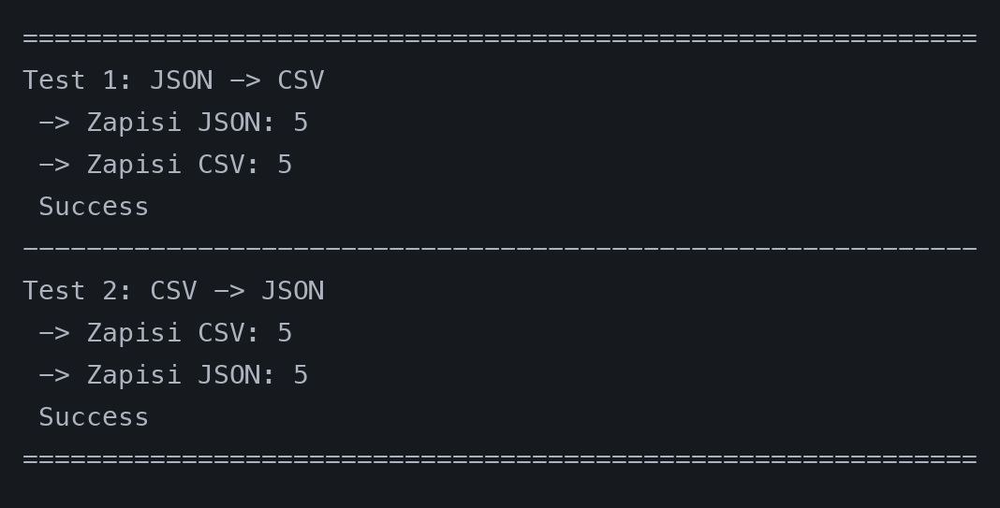
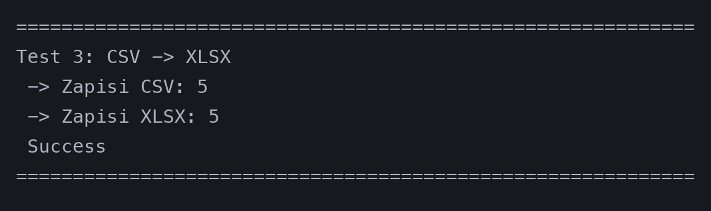

# ЛР05

## Задание A

### 1. json_to_csv

Конвертирует данные из JSON-файла со списком словарей в формат CSV. Проверяет корректность типов данных, собирает все уникальные ключи и записывает строки с заголовком.

```python
def json_to_csv(json_path: str | Path, csv_path: str | Path) -> None:
    json_target = Path(json_path)
    csv_target = Path(csv_path)

    if not json_target.exists():
        raise FileNotFoundError(f"Файл не найден: {json_target}")
    if not json_target.is_file():
        raise ValueError(f"Указанный путь не является файлом: {json_target}")

    try:
        with json_target.open("r", encoding="utf-8") as f:
            data = json.load(f)
    except JSONDecodeError as e:
        raise ValueError(f"Ошибка декодирования JSON: {e}")

    if not isinstance(data, list):
        raise TypeError("Корневой элемент JSON должен быть списком")
    if len(data) == 0:
        raise ValueError("JSON-список не должен быть пустым")
    if not all(isinstance(item, dict) for item in data):
        raise ValueError("Все элементы списка должны быть словарями")

    all_keys = set()
    for row in data:
        all_keys.update(row.keys())

    headers = sorted(list(all_keys))

    if not csv_target.parent.exists():
        csv_target.parent.mkdir(parents=True, exist_ok=True)

    with csv_target.open("w", newline="", encoding="utf-8") as f:
        writer = csv.DictWriter(f, fieldnames=headers, extrasaction="ignore")
        writer.writeheader()
        writer.writerows(data)
```

### 2. csv_to_json

Выполняет обратную конвертацию CSV-файла в JSON-файл со списком объектов. Автоматически определяет диалект и разделитель с помощью `csv.Sniffer`, проверяет наличие заголовков и согласованность структуры всех строк.

```python
def csv_to_json(csv_path: str | Path, json_path: str | Path) -> None:
    csv_target = Path(csv_path)
    json_target = Path(json_path)

    if not csv_target.exists():
        raise FileNotFoundError(f"Файл не найден: {csv_target}")
    if not csv_target.is_file():
        raise ValueError(f"Указанный путь не является файлом: {csv_target}")

    with csv_target.open("r", encoding="utf-8") as f:
        sample = f.read(2048)
        if not sample.strip():
            raise ValueError("CSV-файл не должен быть пустым")
        f.seek(0)

        sniffer = csv.Sniffer()
        try:
            dialect = sniffer.sniff(sample)
        except csv.Error:
            dialect = csv.excel

        if not sniffer.has_header(sample):
            raise ValueError("CSV-файл должен содержать заголовок")

        reader = csv.DictReader(f, dialect=dialect)
        data = list(reader)

    if len(data) == 0:
        raise ValueError("CSV-файл должен содержать как минимум одну строку с данными")
    check_headers(data)

    if not json_target.parent.exists():
        json_target.parent.mkdir(parents=True, exist_ok=True)

    with json_target.open("w", encoding="utf-8") as f:
        json.dump(data, f, indent=2, ensure_ascii=False)
```

### Тесты задания А



## Задание B

### csv_to_xlsx

Конвертирует данные из CSV в файл Excel (`.xlsx`) с использованием библиотеки `openpyxl`. Считывает строки, валидирует структуру данных и подбирает ширину колонок по максимальной длине содержимого ячеек.

```python
def csv_to_xlsx(csv_path: str | Path, xlsx_path: str | Path) -> None:
    csv_target = Path(csv_path)
    xlsx_target = Path(xlsx_path)

    if not csv_target.exists():
        raise FileNotFoundError(f"Файл не найден: {csv_target}")
    if not csv_target.is_file():
        raise ValueError(f"Указанный путь не является файлом: {csv_target}")

    with csv_target.open("r", encoding="utf-8") as f:
        sample = f.read(2048)
        if not sample.strip():
            raise ValueError("CSV-файл не должен быть пустым")
        f.seek(0)

        try:
            dialect = csv.Sniffer().sniff(sample)
        except csv.Error:
            dialect = csv.excel

        reader = csv.reader(f, dialect=dialect)
        rows = list(reader)

    if len(rows) <= 1:
        raise ValueError(
            "Недостаточно данных в CSV: требуется заголовок и как минимум одна строка с данными"
        )
    check_rows(rows)

    wb = openpyxl.Workbook()
    ws = wb.active
    ws.title = "Sheet1"

    for row in rows:
        ws.append(row)

    for col in ws.columns:
        max_len = max(len(str(cell.value or "")) for cell in col)
        col_letter = openpyxl.utils.get_column_letter(col[0].column)
        ws.column_dimensions[col_letter].width = max(max_len + 3, 8)

    if not xlsx_target.parent.exists():
        xlsx_target.parent.mkdir(parents=True, exist_ok=True)

    wb.save(xlsx_target)
```

### Тесты задания B


